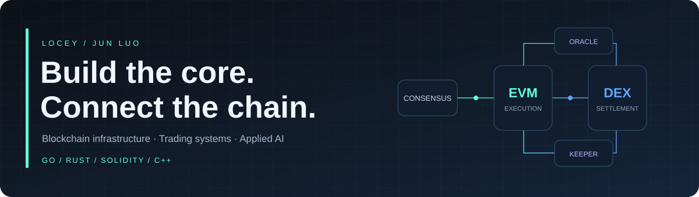
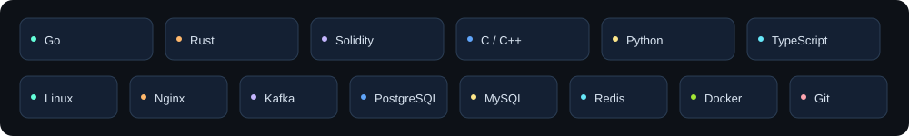

  

  
  
  

### Building the systems behind the trade

I'm **Jun Luo (locey)**, a senior blockchain engineer working across chain nodes, native DEX engines, smart contracts, and backend infrastructure.

- **Now · BitMart** — Go-Ethereum node extensions, EVM / DEX execution, Oracle, and Keeper infrastructure for spot, perpetual futures, and TradFi markets.
- **Previously · PumpBTC** — core development for a project supporting **23 chains, 300K users, and $500M+ TVL**; cross-chain monitoring, Rust SDKs, and staking contracts.
- **Systems foundation · ZTE** — Nginx / Linux / TCP optimization, with **50%+ improvement in single-server bandwidth**.
- **Education** — M.Sc., Zhejiang University · B.Eng., Xi'an Jiaotong University.
- **Also exploring** — AI agents, DeFi automation, and AI-assisted engineering.

### What I work on

**Chain infrastructure** · consensus integration · deterministic execution · cross-engine state · snapshot / replay recovery
**Trading systems** · order book matching · margin & settlement · liquidation / ADL · multi-source pricing
**Application infrastructure** · cross-chain monitoring · event-driven backends · SDKs · AI workflows

### Engineering toolkit

  

### Selected public projects

#### [AlanSwap →](https://github.com/locey/AlanSwap)
An exchange project with smart routing, organized into Go backend, frontend, and contract components.

#### [Bridge Monitor →](https://github.com/locey/bridge_monitor)
A cross-chain data monitoring service for bridge activity, built with Go and PostgreSQL.

#### [Motor AI →](https://github.com/locey/Motor-AI-Fe)
An AI workflow for motor design, connecting my electrical engineering background with software development.

#### [Personal CV →](https://github.com/locey/mycv)
My English engineering portfolio, built with Next.js and TypeScript. [View the live site](https://www.locey.fun/).

### GitHub activity

  
  

Cards reflect GitHub account activity, including experiments and automation; contribution counts are not a measure of engineering output. The `empty` repository contains synthetic contribution-graph experiments. Commercial project source code is not included here.

---

<b>From consensus to settlement.</b> Blockchain infrastructure · Trading systems · Applied AI

