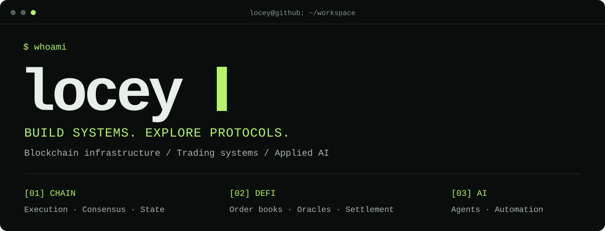
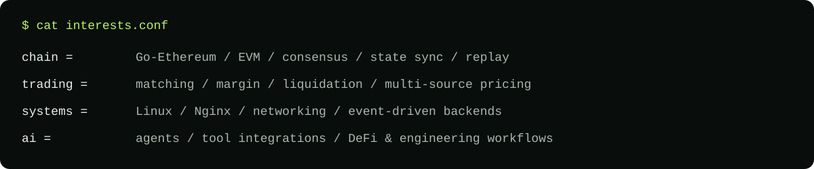
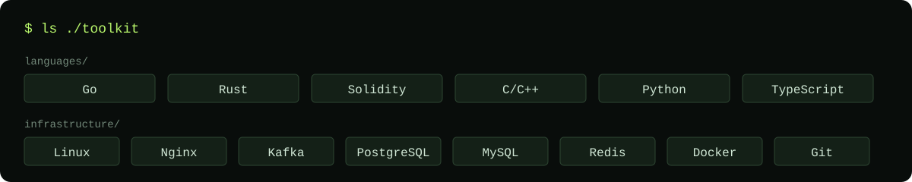
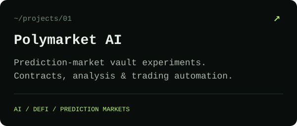
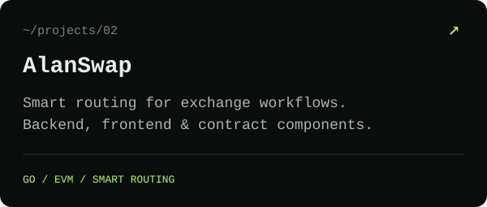
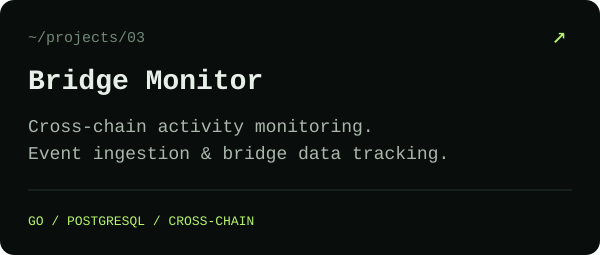
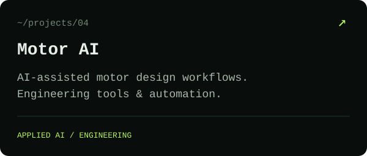
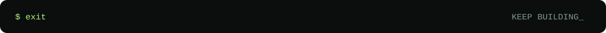

  

  
  

I build blockchain infrastructure, explore trading systems, and share experiments in protocols and applied AI.

### `~/projects` — selected public work

  
  

  
  

<b>Read project descriptions</b>

- [Polymarket AI](https://github.com/locey/polymarket_ai): experimental AI-assisted prediction-market vault, combining contracts, market analysis, and trading automation.
- [AlanSwap](https://github.com/locey/AlanSwap): smart routing exchange project with backend, frontend, and contract components.
- [Bridge Monitor](https://github.com/locey/bridge_monitor): a Go and PostgreSQL service for monitoring cross-chain bridge activity.
- [Motor AI](https://github.com/locey/Motor-AI-Fe): AI-assisted tools and automation for motor design workflows.

### `$ git insights`

  
  

